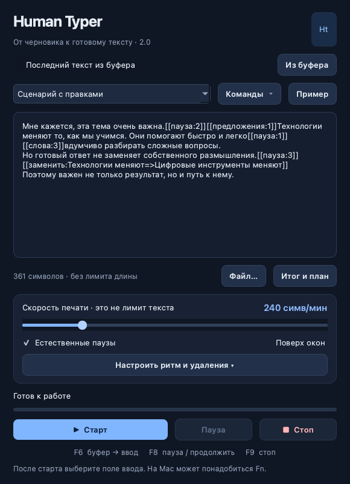

# Human Typer 2

Настольное приложение для **macOS и Windows**: читает последний скопированный текст и разыгрывает процесс написания — от наброска до готового текста, с удалением слов и предложений, возвращением к предыдущим формулировкам и паузами. Русский интерфейс, Unicode-ввод без смены раскладки и без вставки всего текста.



## Возможности

- **Сценарии правок:** команды `[[пауза:2]]`, `[[слова:2]]`, `[[предложения:1]]`, `[[стереть:12]]`, `[[заменить:старое=>новое]]`, `[[скорость:180]]`. Команды не печатаются в документ.
- Замена в середине уже набранного текста: возврат курсора, постепенное удаление, новая формулировка, возврат в конец.
- Предпросмотр итогового текста и плана действий до запуска, готовый пример, меню вставки команд, загрузка `.txt` / `.md` / `.htype`.
- **Без лимита длины текста.** Размер ограничен памятью системы. Скорость в симв/мин — не лимит объёма. Проверяется сценарий на 1 000 001 символ; нажатия разворачиваются по мере выполнения.
- Скорость 20–1200 символов в минуту, её можно менять во время работы.
- Неровный ритм, короткие паузы между словами и после пунктуации.
- Редкие опечатки: неверная буква → Backspace → правильная буква. Частота 0–10%; 0 отключает исправления.
- Пауза, продолжение, остановка и отсчёт перед каждым запуском/продолжением.
- Настраиваемое число нажатий Backspace перед новым вводом; команды сценария не могут удалить больше текста, чем уже написал сам сценарий.
- Текст из буфера либо собственный текст в окне; окно поверх других окон.
- Автоматическая пауза при смене активного приложения или нажатии Ctrl, Alt, Shift, Cmd.
- Текст и буфер остаются в памяти. Сохраняются только настройки. Приложение не использует сеть.

## Быстрый запуск

Требуется Python **3.11+**, macOS **14+** или Windows **10/11**. Для готовых сборок Python не нужен: скачайте архив `.app` или `.exe` из [Releases](https://github.com/daryynchik/human-typer/releases).

```sh
git clone https://github.com/daryynchik/human-typer.git
cd human-typer
python3 -m venv .venv
source .venv/bin/activate
python -m pip install .
python -m human_typer
```

На Windows (PowerShell):

```powershell
git clone https://github.com/daryynchik/human-typer.git
cd human-typer
py -3.12 -m venv .venv
.\.venv\Scripts\python.exe -m pip install .
.\.venv\Scripts\python.exe -m human_typer
```

## Использование

1. Скопируйте текст. По умолчанию каждый старт читает **текущий** буфер. «Из буфера» показывает его в окне; редактирование переключает источник на текст окна.
2. Выберите «Сценарий с правками», чтобы исполнить команды `[[…]]`, или «Обычный текст», чтобы печатать всё буквально. «Пример» загружает черновик с правками; «Итог и план» проверяет сценарий и показывает результат. [Полная справка и пример эссе](docs/SCENARIOS.md).
3. Настройте скорость. В «Настроить ритм и удаления» можно менять разброс, опечатки, удаление перед вводом и отсчёт.
4. Нажмите «Старт» и до конца отсчёта поставьте курсор в нужное поле **другого приложения**.
5. **F8** приостанавливает печать, правку или ожидание. Ещё одно F8 запускает отсчёт для продолжения; снова выберите то же поле. **F9** останавливает текущий ввод.
6. **F6** запускает ввод последнего текста из буфера в выбранном режиме, когда предыдущий запуск завершён или остановлен.

Например, скопируйте одну строку и выберите «Сценарий с правками»:

```text
Это плохой[[слова:1]]первый набросок.[[пауза:2]][[заменить:первый набросок=>продуманный текст]]
```

Приложение напишет черновой вариант, исправит слово, подождёт, затем вернётся к фразе и перепишет её. В итоге останется: **«Это продуманный текст.»**

| Клавиша | Действие |
|---|---|
| F6 | Новый запуск из текущего буфера |
| F8 | Пауза / продолжить после отсчёта |
| F9 | Остановить |

На Mac используйте **Fn + F6/F8/F9**, если функциональные клавиши управляют системой. Горячие клавиши не блокируются для других приложений: если программа использует F6/F8/F9, выбирайте кнопки в окне.

Для точного ровного ввода установите разброс и ошибки в 0 и отключите естественные паузы. Удаление перед вводом выполняется только один раз за запуск; продолжение после паузы его не повторяет. Остановка оставляет уже набранный текст, в том числе ещё не исправленную опечатку.

## Разрешения и особенности

**macOS:** при первом запуске разрешите приложение в «Настройки системы → Конфиденциальность и безопасность → Универсальный доступ». Для горячих клавиш система также может потребовать «Мониторинг ввода». При запуске из исходников разрешение может понадобиться Terminal или используемой среде Python. После изменения разрешений перезапустите приложение. Скачанная `.app` не подписана сертификатом Apple и не нотарифицирована: если Gatekeeper блокирует запуск, используйте «Открыть всё равно» в настройках безопасности для этой сборки.

**Windows:** обычное приложение не может печатать в окно, запущенное с правами администратора. Откройте целевую программу без повышения прав. Готовый `.exe` не имеет сертификата подписи, поэтому Windows может показать предупреждение SmartScreen.

Переносы строк по умолчанию вводятся как **Shift+Enter**; можно выбрать Enter. Поведение зависит от целевого приложения: Enter в чате может отправить сообщение. Табуляции заменяются четырьмя пробелами, чтобы Tab не переключал поле. CRLF/CR приводятся к LF. Управляющие символы отклоняются. Печать не меняет содержимое системного буфера.

Автокоррекция, умные кавычки и автоотступы целевого редактора могут изменить результат; отключите их, если нужна точная копия. Автоматическая пауза следит за активным **приложением**, а не за полем или вкладкой внутри него. При продолжении сценария вернитесь в то же поле и не двигайте курсор вручную: правки рассчитаны относительно уже отправленных нажатий. Ввод в игры и защищённые системные поля не гарантируется.

## Разработка и сборка

```sh
python -m pip install '.[dev]'
python -m pytest
python -m ruff check .
python scripts/build.py
```

Собирать нужно на целевой системе: macOS → `dist/Human Typer.app`, Windows → `dist/Human Typer.exe`. Архитектура macOS-сборки соответствует архитектуре Python. GitHub Actions проверяет проект на macOS и Windows. При push тега `v*` создаёт релиз со сборками macOS Apple Silicon, macOS Intel и Windows x64; `workflow_dispatch` только собирает артефакты.

Ядро работает в цикле Qt: один ввод на тик, без блокирующих ожиданий. Задержавшийся кадр не вызывает пачку символов. Сценарий полностью проверяется до доступа к клавиатуре; план хранит крупные фрагменты и разворачивает отдельные нажатия лениво. Нативные бэкенды используют [CoreGraphics](https://developer.apple.com/documentation/coregraphics/cgevent/keyboardsetunicodestring(stringlength:unicodestring:)) и [Windows SendInput](https://learn.microsoft.com/en-us/windows/win32/api/winuser/nf-winuser-sendinput) с UTF-16. Тесты проверяют итоговый Unicode-текст, исправления, сценарные удаления и замены, ошибки команд, миллион символов, остановку, фокус, разрешения, обновление скорости, интерфейс и структуру Windows INPUT.

Лицензия: MIT.
